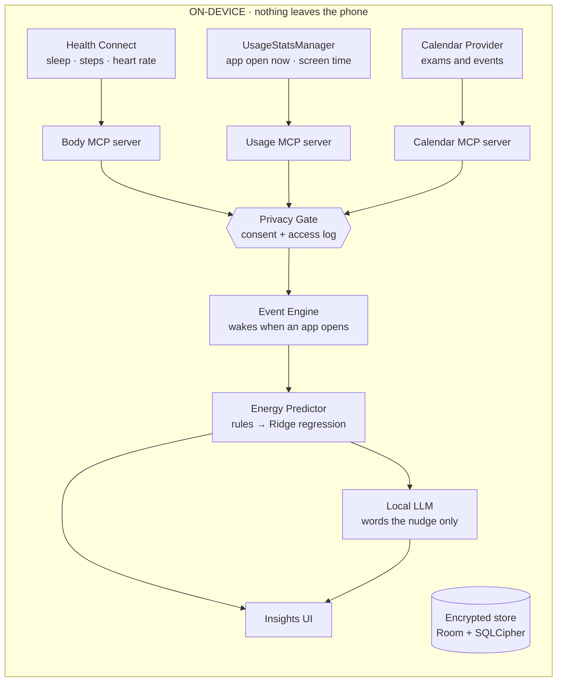

# AtmaBodh — your data, your intelligence

**wHACKiest 2026 · Track: Know Thyself**

A private, on-device AI that connects your **body** (sleep, heart rate, steps), your **phone usage** and your **calendar**, predicts **tomorrow's energy**, explains **why today went badly**, and nudges you **at the right moment**. Nothing leaves the device.

> 12:05 AM. Instagram has been open for 40 minutes. You slept late three nights in a row and you have an exam at 10 AM.
> Every app knows one piece of this. AtmaBodh connects them:
> *"3 late nights in a row and your exam is at 10 AM. Sleep now and tomorrow's energy is about 47%. One more hour on Instagram drops it to about 30%."*

---

## What this repository contains

This is the **MVP prototype of the AtmaBodh engine**, written in Python so the logic can be run, tested and shown on any laptop. The final product is an Android app (see [Roadmap](#roadmap-to-the-android-app)); every module here maps 1:1 to a part of that app.

| Works now in this prototype | How |
|---|---|
| Daily **Energy Score** calculated automatically from body signals vs your personal baseline | `atmabodh/engine/energy.py` |
| **Personal prediction model**: rules for the first 14 days, then **Ridge regression** | `atmabodh/engine/predictor.py` |
| **"Why was today bad?"**: top reasons in plain language | `atmabodh/engine/insights.py` |
| **Real-time nudge** that fires only when 3 conditions line up, with "what if" predictions and a daily cap | `atmabodh/engine/nudge.py` |
| **Privacy Gate**: per-source consent switches + access log for every read | `atmabodh/gate.py` |
| **Three MCP servers** (body, usage, calendar), each consent-checked and logged | `mcp_servers/` |
| Nudge wording by a **local LLM** (Ollama), with a template fallback | `atmabodh/engine/phraser.py` |
| Dashboard showing the app screens | `dashboard.py` |

**Honest note:** the prototype runs on 8 weeks of **synthetic** student data (`atmabodh/data/simulate.py`), so it can be demoed anywhere, offline. The simulation encodes simple cause and effect (late screen time → later bedtime → less sleep → worse body signals the next day) so the model has a real pattern to learn. Because the data is simulated, the backtest error shown in the demo is optimistic; real accuracy will be measured on pilot data. Reading real data from Health Connect, UsageStatsManager and the Calendar Provider is the Android step.

---

## Run it (about 2 minutes)

```bash
git clone <this-repo-url> && cd atmabodh
python -m venv .venv && source .venv/bin/activate      # Windows: .venv\Scripts\activate
pip install -r requirements.txt

python demo.py              # the 12:05 AM story in the terminal
streamlit run dashboard.py  # the app screens in your browser
python -m pytest -q         # tests
```

Optional, for LLM-worded nudges: install [Ollama](https://ollama.com), run `ollama pull gemma3:1b`, then `python demo.py`. Without it, the template text is used. Model name is configurable with `ATMABODH_LLM_MODEL`.

Try the privacy gate: `python demo.py --calendar-off`, or use the switches in the dashboard sidebar, then look at the access log.

---

## Architecture



### The pipeline, step by step

1. **Energy Score (no user input).** For each day we compare resting heart rate, HRV, steps and the first phone unlock with *this person's* last 28 days (z-scores), flip signs so "+" means more energy, and map to 0–100. Missing signals (e.g. no smartwatch) are skipped, so phone-only users still get a score.
2. **Personal model.** Inputs are *tonight's behaviour*: expected sleep, screen time after 11 PM, 3-night sleep debt, steps. The label is *tomorrow's* Energy Score. Inputs and label come from different things, so the model learns a real relationship instead of re-learning a formula.
   - Days 1–14: fixed rules (cold start).
   - After that: `StandardScaler` + `Ridge(alpha=1.0)`, trained only on this user's data.
   - Every prediction is explainable: each input's contribution in points vs the user's usual value.
3. **Real-time decision.** When an app comes to the foreground, we nudge only if (1) it is after 11:30 PM on a social/video/game app for 20+ min, (2) there were 2+ late nights or 2+ h sleep debt, and (3) an important event is within 14 h. Then two "what if" predictions: *sleep now* vs *one more hour*.
4. **Wording.** Numbers come from the model; the local LLM only rewrites the given facts into a friendly sentence, so it cannot invent a number.

### Why these choices (each one won a comparison)

| Layer | Choice | Why |
|---|---|---|
| Prediction | Rules → Ridge regression | Works from day 1, stable on a few weeks of data, explainable. The LLM never predicts numbers. |
| Label | Next-day body signals | Fully automatic; users don't have to rate their energy every morning |
| Tool layer | MCP, one server per source | Each source can be switched off and every access is logged (fallback: plain function calling) |
| Privacy | Gate + summaries only | The LLM sees "3 late nights, 6.5 h debt", never raw timestamps |
| App (target) | Kotlin + Jetpack Compose | Health Connect, MCP Kotlin SDK and LiteRT-LM are Kotlin-first |
| Health data (target) | Health Connect | Google Fit APIs are deprecated in 2026; data stays on-device; one link covers WHOOP, Oura, Samsung |
| Screen activity (target) | UsageStatsManager | Narrower than AccessibilityService, which can read every screen |
| On-device LLM (target) | Gemma 4 E2B on LiteRT-LM | Offline, supports function calling, not limited to a few flagship phones |
| Storage (target) | Room + SQLCipher, key in Android Keystore | Encrypted at rest |

---

## Project layout

```
atmabodh/
  config.py            settings and thresholds
  gate.py              Privacy Gate (consent + access log)
  data/store.py        local SQLite store (daily aggregates only)
  data/simulate.py     8 weeks of synthetic data for the demo
  tools/body.py        body data tools        -> Health Connect on Android
  tools/usage.py       phone usage tools      -> UsageStatsManager on Android
  tools/calendar.py    calendar tools         -> Calendar Provider on Android
  engine/energy.py     Energy Score from body signals
  engine/predictor.py  rules / Ridge personal model + explanations
  engine/insights.py   "Why was today bad?"
  engine/nudge.py      real-time decision + what-if predictions
  engine/phraser.py    local LLM wording with template fallback
mcp_servers/           body, usage and calendar MCP servers (stdio)
demo.py                terminal demo
dashboard.py           Streamlit prototype of the app screens
tests/                 pytest tests
```

### Using the MCP servers

Each server runs over stdio, e.g. `python mcp_servers/body_server.py`. To try one in an MCP client, add it to the client's config, for example:

```json
{ "mcpServers": { "atmabodh-body": { "command": "python", "args": ["mcp_servers/body_server.py"] } } }
```

All tool calls go through the Privacy Gate, so they respect the consent switches and appear in the access log.

---

## Roadmap to the Android app

| Step | What |
|---|---|
| 1 | Kotlin app: read sleep, steps, heart rate via Health Connect; app usage via UsageStatsManager in a foreground service; events via Calendar Provider |
| 2 | Port `energy.py` and `predictor.py` (Ridge is a few lines of linear algebra) to Kotlin; store in Room + SQLCipher |
| 3 | MCP servers via the official Kotlin SDK; Privacy Gate and access-log screen |
| 4 | Gemma 4 E2B on LiteRT-LM for nudge wording; Jetpack Compose UI |
| 5 | Pilot with students at our college; measure sleep debt, late-night screen minutes and nudge acceptance |

## Team

wHACKiest 2026 · DSATM, Bengaluru
